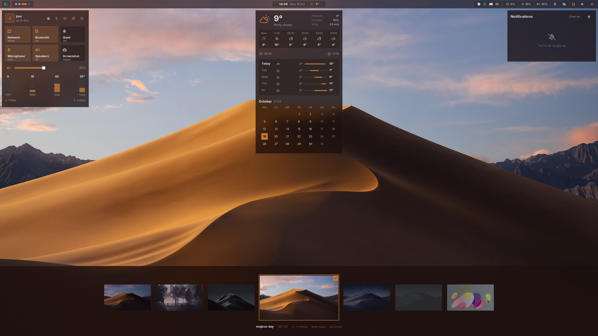

# amane-shell

A desktop shell for [niri](https://github.com/YaLTeR/niri), built with [Amane](https://github.com/MystiaFin/amane). Bar, tray,
dashboard, launcher, notifications, calendar and weather, wallpaper picker, and sound, Bluetooth, network, clipboard and
power dropdowns. Colours follow the wallpaper.




https://github.com/user-attachments/assets/a843d4c3-b076-4d88-abff-8120f4c5d30a


## Requirements

- niri
- the Amane CLI from [this fork](https://github.com/beefsizzle/amane), which frees the GPU memory of hidden windows
  and adds `LayerWindow::solid`
- Adwaita Sans, JetBrainsMono Nerd Font
- ImageMagick, wl-clipboard, cliphist, `pactl` (PipeWire or PulseAudio), NetworkManager, BlueZ, curl, jq
- optional: fprintd with an enrolled finger, to unlock the lock screen with a fingerprint

## Install

```sh
git clone https://github.com/beefsizzle/amane
cd amane && ./install.sh && cd ..

git clone https://github.com/beefsizzle/amane-shell
amane target amane-shell
amane compile
amane run
```

Stop any other bar, notification daemon or tray host first.

## niri

```kdl
spawn-at-startup "amane" "run"
spawn-at-startup "wl-paste" "--type" "text" "--watch" "cliphist" "-max-items" "200" "store"
spawn-at-startup "wl-paste" "--type" "image" "--watch" "cliphist" "-max-items" "200" "store"

binds {
    Mod+Space   { spawn "amane" "ipc" "call" "toggle" "launcher"; }
    Mod+Shift+D { spawn "amane" "ipc" "call" "toggle" "dashboard"; }
    Mod+Shift+C { spawn "amane" "ipc" "call" "toggle" "calendar"; }
    Mod+Shift+N { spawn "amane" "ipc" "call" "toggle" "notifications"; }
    Mod+Shift+W { spawn "amane" "ipc" "call" "toggle" "wallpapers"; }
    Mod+Ctrl+V  { spawn "amane" "ipc" "call" "toggle" "clipboard"; }
    Alt+X       { spawn "amane" "ipc" "call" "toggle" "power"; }
    Super+Alt+L { spawn "amane" "ipc" "call" "lock"; }
}
```

Blur behind the bar and panels: add [`dev/niri-layer-rules.kdl`](dev/niri-layer-rules.kdl).

## Config

In `~/.config/amane-shell/`:

- `location`: `lat lon`, for the weather
- `wallpaper-dir`: wallpaper folder, default `~/Pictures/Wallpapers`

## IPC

```
amane ipc call toggle dashboard|calendar|notifications|wallpapers|launcher|power|network|audio|bluetooth|clipboard|all|close
amane ipc call wallpaper <path>
amane ipc call lock
amane ipc call sleep
```

## License

[MIT](LICENSE)
